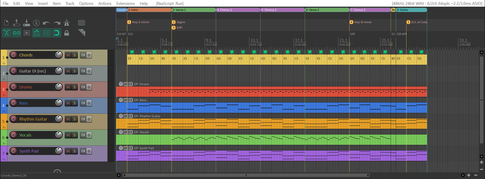

# GP-Link – Guitar Pro ⇄ REAPER Sync

**Song in Guitar Pro schreiben, in REAPER aufnehmen. GP-Link hält beides synchron.**

Eine Guitar-Pro-Datei (`.gp`, `.gpx`, `.gp5`) in die REAPER-Spuransicht ziehen: GP-Link legt MIDI-Spuren, Tempomap,
Section-Regionen, Marker, eine Akkordspur und Lyrics an. Speicherst du danach in Guitar Pro, aktualisiert REAPER
automatisch. Audio, FX und Mix bleiben unangetastet.

Die Oberfläche von GP-Link ist englisch. [English README](README.md)

## Installation

1. `reaper_gplink-x64.dll` aus dem [neuesten Release](../../releases/latest) herunterladen.
2. REAPER beenden.
3. Die DLL nach `%APPDATA%\REAPER\UserPlugins\` kopieren.
4. REAPER starten. Im Menü erscheint **Extensions → GP-Link**.

Voraussetzungen: Windows 10/11 (64 Bit), REAPER 6 oder 7. Dateien aus Guitar Pro 5 bis 8 (`.gp5`, `.gpx`, `.gp`).

## Anleitungen

- [LIESMICH.md](docs/de/LIESMICH.md): Benutzung, Import-Dialog, Regeln, relative Pfade für Bands
- [LIESMICH-Extension.md](docs/de/LIESMICH-Extension.md): die REAPER-Erweiterung, selbst bauen
- [Englisches Handbuch](scripts/README.md)

## Lizenz

[MIT](LICENSE). GP-Link ist ein unabhängiges Projekt und gehört weder zu Arobas Music (Guitar Pro) noch zu Cockos (REAPER).
