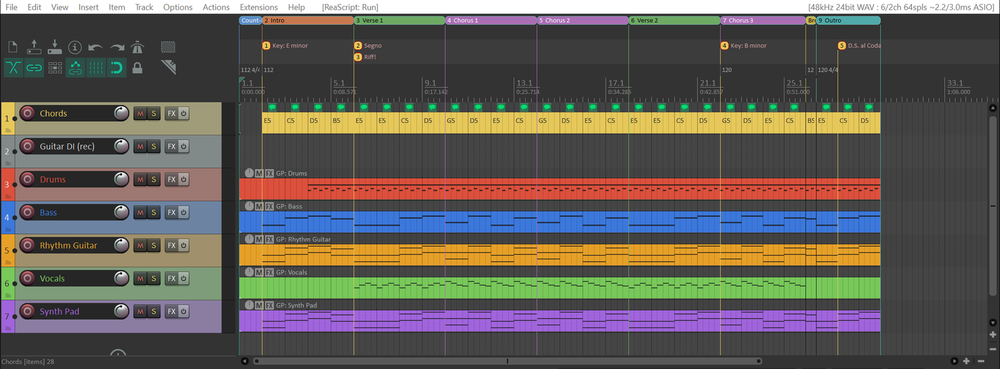
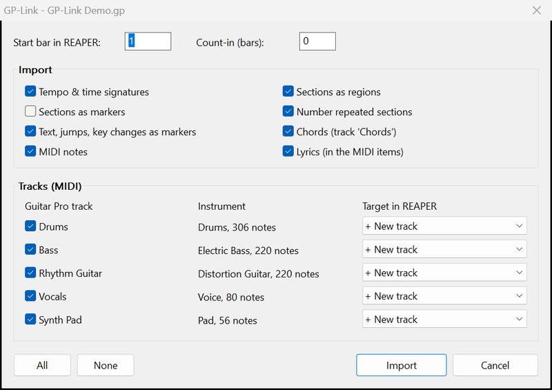
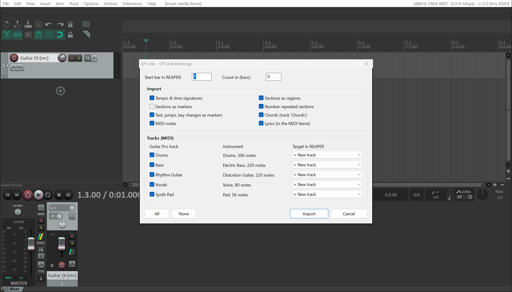

# GP-Link – Guitar Pro ⇄ REAPER sync

**Write the song in Guitar Pro, record it in REAPER. GP-Link keeps both in sync.**

Drop a Guitar Pro file (`.gp`, `.gpx`, `.gp5`) onto REAPER's arrange view and GP-Link builds MIDI tracks,
tempo map, section regions, markers, a chord track and lyrics from it. Save in Guitar Pro again and REAPER updates
automatically — your audio, FX and mix stay untouched.

[Deutsche Anleitung](README.de.md)



## Features

- **Drag & drop**: drop a `.gp`, `.gpx` or `.gp5` onto the arrange view like a WAV file. The bar you drop it on
  becomes the start bar.
- **Guitar Pro 5, 6, 7 and 8**: `.gp5` (also saved by TuxGuitar and many tab sites), `.gpx` and `.gp`.
  Auto-sync works with all of them.
- **Auto-sync**: when Guitar Pro saves, REAPER updates about two seconds later. It waits while you are recording.
  Every sync is one undo step.
- **Import dialog**: choose which parts to import and where each Guitar Pro track goes.
  - Tempo & time signatures
  - Sections as regions and/or markers, repeated sections numbered ("Chorus 1", "Chorus 2")
  - Text, jumps and key changes as markers (Segno, D.S. al Coda, "Key: E minor" …)
  - Chord track with one item per chord
  - MIDI notes, lyrics as MIDI lyric events
  - Count-in bars before the song
  - Per track: import yes/no, new track or an existing REAPER track
- **Import structure only**: take tempo, sections, markers and chords from Guitar Pro without any MIDI,
  e.g. as a skeleton for recording.
- **Safe re-sync**: only GP-Link's own items, regions and markers are replaced. Lock a GP item (Item → Lock) to freeze
  that part and keep editing it in REAPER.
- **Drag items onto your instrument tracks**: move a GP item onto e.g. a VSTi track and the next sync asks
  whether that GP track should sync there from now on.
- **Made for bands**: the link is stored relative to the project as well, so a shared folder (Google Drive,
  Dropbox …) works even if every band member has a different drive letter.
- Guitar Pro details: repeats and alternate endings are written out, ties, grace notes, dynamics, accents, ghost notes,
  drum articulations, simile bars, optional keyswitches for palm mute / dead notes / harmonics.

<p align="center"></p>

## Installation

1. Download `reaper_gplink-x64.dll` from the [latest release](../../releases/latest).
2. Quit REAPER.
3. Copy the DLL to `%APPDATA%\REAPER\UserPlugins\`.
4. Start REAPER. The menu **Extensions → GP-Link** appears.

The extension contains the Lua engine and installs it to `Scripts\GP-Link\` on every start.
Your settings in `Scripts\GP-Link\gplink_config.lua` are never overwritten.

Requirements: Windows 10/11 (64-bit), REAPER 6 or 7. Files from Guitar Pro 5-8 (`.gp5`, `.gpx`, `.gp`).
Even older files (`.gp3`, `.gp4`): open them once in Guitar Pro and save as `.gp5` or `.gp`.

**Scripts only:** if you'd rather not use the extension, copy the `scripts/` folder to `REAPER\Scripts\GP-Link\` and load
the actions manually. Without the extension there is no drag & drop: import via the action and its file browser.
See the [manual](scripts/README.md).

## Usage

| What | How |
|---|---|
| Import a song | Drag the Guitar Pro file onto the arrange view, or *Extensions → GP-Link → Link Guitar Pro file / map tracks…* |
| Change parts, tracks, start bar | Run the import again on the same file and answer **No** ("keep this file") |
| Structure only, no MIDI | *Extensions → GP-Link → Import structure only from Guitar Pro…* |
| Sync manually | *Extensions → GP-Link → Sync now* |
| Turn auto-sync on/off | *Extensions → GP-Link → Auto-sync*, or the action "GP-Link: auto-sync on/off" (toolbar-ready) |
| Unlink (tracks are kept) | *Extensions → GP-Link → Unlink Guitar Pro file…* |
| Settings | `Scripts\GP-Link\gplink_config.lua` (MIDI channels, velocities, keyswitches) |

Rules of thumb: edit notes in Guitar Pro only, every sync replaces the GP items. Your audio items, FX, sends,
automation and your own regions and markers are never touched. Details: [manual](scripts/README.md).



## Limitations

- Jumps (D.S., D.C., Coda, Fine) are shown as markers, but the bars play linearly.
- Bends, slides and vibrato are not converted to pitch bend yet.
- One-way only: Guitar Pro → REAPER.
- The extension is Windows-only (the Lua scripts are written to work on macOS too, but this is untested).

## Repository layout

```
scripts/        Lua engine + REAPER actions (also embedded into the extension)
extension/      C++ REAPER extension (drag & drop, import dialog, auto-sync timer, menu)
tests/          tests against a mocked REAPER API
tools/          generators for the demo songs used by tests and screenshots (.gp, .gp5, .gpx)
examples/       GP-Link Demo.gp / .gp5 (generated test files)
docs/           screenshots, German documentation
```

`examples/GP-Link Demo.gp` and `.gp5` are small generated songs that contain exactly the parts of the formats
GP-Link reads. They are test fixtures; Guitar Pro itself may refuse to open them.

## Building

The extension is built with [Zig](https://ziglang.org/)'s clang, installed via pip, so no Visual Studio is needed:

```bash
pip install ziglang
python extension/build.py
```

The result is `extension/dist/reaper_gplink-x64.dll`. `build.py` first embeds the Lua files from `scripts/` into
`extension/src/gplink_embedded.h`, then compiles for `x86_64-windows-gnu`. Only C function pointers cross the
boundary to REAPER, so the compiler doesn't have to match REAPER's.

How it fits together:
- `.gp`, `.gpx` and `.gp5` are registered as media types. A dropped file becomes a placeholder item; a timer
  picks it up, removes it and runs the import at that position.
- File formats: `.gp` is a zip with `score.gpif` (XML). `.gpx` is a compressed container holding the same XML.
  `.gp5` is a binary format, read by `scripts/gplink_formats.lua` into the same internal model.
- The import dialog is a native Win32 dialog. Lua writes the dialog description to the ExtState `GPLINK_DLG/spec`,
  calls the internal action `_GPLINK_IMPORT_DIALOG`, and reads the answer from `GPLINK_DLG/result`.
- Auto-sync: a timer checks the linked file's modification time and size every second. When the file has stayed
  unchanged twice in a row, `gplink_autosync_once.lua` runs and only syncs if the content hash changed.

## Tests

```bash
pip install lupa pyguitarpro
python tests/test_gplink.py
```

The tests run the real Lua scripts against a mocked REAPER API (Windows, as the scripts unpack `.gp` files with
`tar.exe`): parser vs. independent Python references (also PyGuitarPro for `.gp5`), `.gpx` container, structure, repeats, import with and without the native
dialog, "structure only", cancel, relative paths, drag & drop, auto-sync and unlink.
CI runs them and builds the DLL on every push.

## License

[MIT](LICENSE). The REAPER SDK headers in `extension/sdk/` are © Cockos Incorporated under their own license.

GP-Link is an independent project and not affiliated with Arobas Music (Guitar Pro) or Cockos (REAPER).
